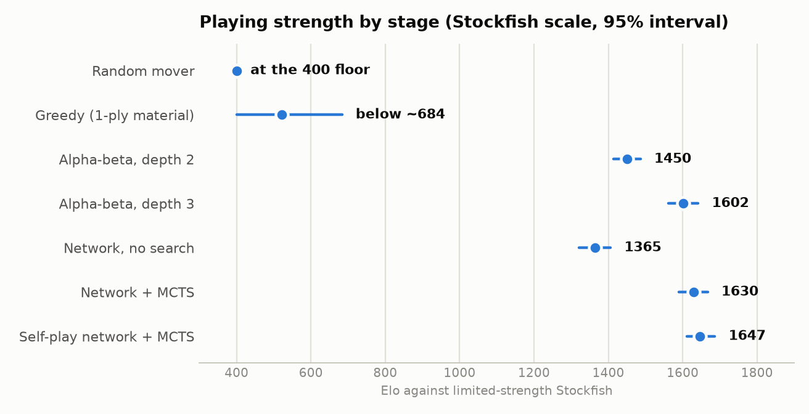
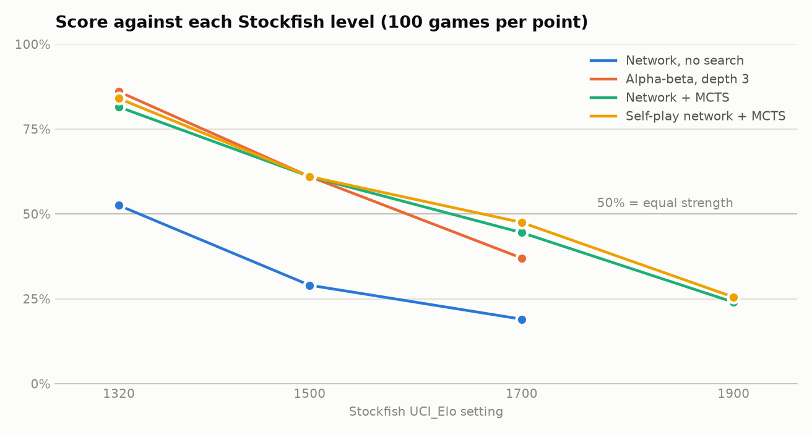
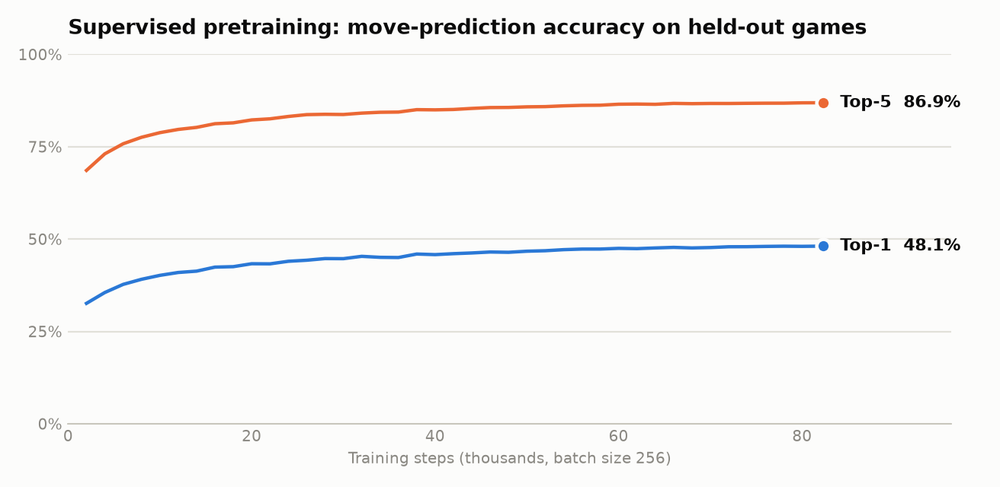
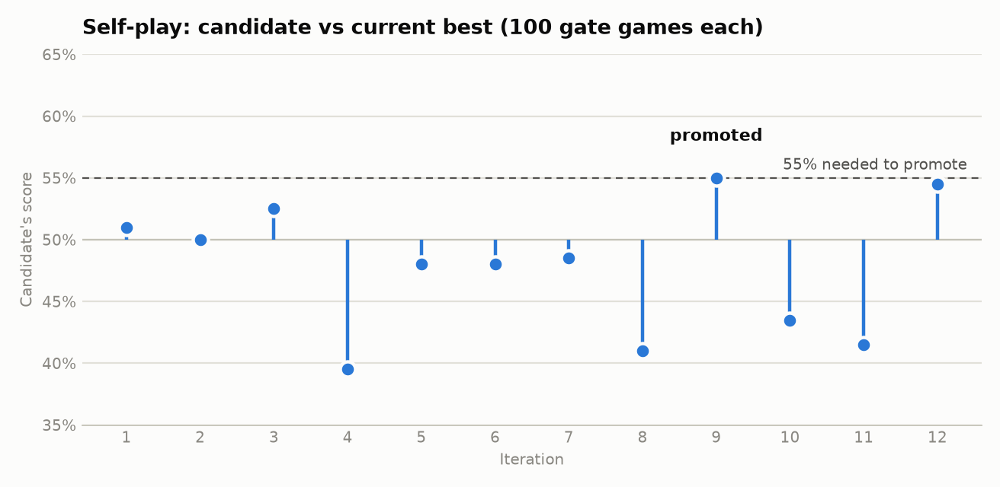
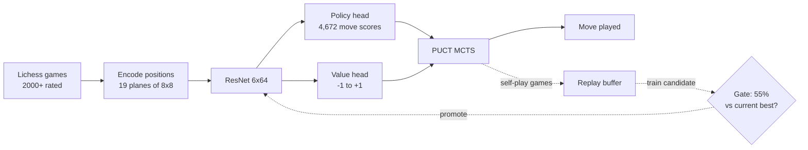

# chessbot


[](https://lichess.org/@/crook72)

An AlphaZero-style chess engine built and trained on a single laptop. A small ResNet learns to predict strong human moves from Lichess games, a Monte Carlo Tree Search (MCTS) turns that network into a player, and a gated self-play loop tries to improve it further. Every stage is measured against limited-strength Stockfish with confidence intervals, and the engine plays live on Lichess as [crook72](https://lichess.org/@/crook72).



## Highlights

- **Complete pipeline, from raw games to a live bot:** data preparation, supervised pretraining, MCTS, self-play reinforcement learning (RL), evaluation, and a UCI engine for Lichess.
- **Search is the big win:** MCTS lifts the same network from 1365 to 1630 Elo on the Stockfish scale, about +265.
- **Measured, not assumed:** 100 games per Stockfish level, alternating colours, a varied opening book, and bootstrap 95% intervals.
- **Honest negative result:** self-play added +17 Elo, which is inside the noise, so no gain is claimed.
- **Small and fast:** a 6-block, 64-filter network with about 505,000 parameters, running on Apple Silicon (PyTorch MPS) with a CPU fallback.
- **Tested:** 138 automated tests, with lint and type checks clean.

## Table of contents

- [Results](#results)
- [How it works](#how-it-works)
- [Live on Lichess](#live-on-lichess)
- [Quick start](#quick-start)
- [Reproducing the pipeline](#reproducing-the-pipeline)
- [Evaluating a player](#evaluating-a-player)
- [Running the Lichess bot](#running-the-lichess-bot)
- [Configuration](#configuration)
- [Tests](#tests)
- [Project layout](#project-layout)
- [Limitations](#limitations)
- [Roadmap](#roadmap)
- [Acknowledgements](#acknowledgements)

## Results

### Strength against Stockfish

Ratings are on Stockfish's `UCI_Elo` scale, which is its own calibration. They are **not** Lichess ratings.

| Player | Rating | 95% interval | Games |
|---|---|---|---|
| Random mover | at the 400 floor | n/a | 100 |
| Greedy (1-ply material) | below about 700 | n/a | 100 |
| Alpha-beta, depth 2 | 1450 | 1413 to 1487 | 300 |
| Alpha-beta, depth 3 | 1602 | 1562 to 1642 | 300 |
| Network, no search | 1365 | 1321 to 1406 | 300 |
| Network + MCTS (100 simulations) | 1630 | 1591 to 1667 | 400 |
| Self-play network + MCTS (100 simulations) | **1647** | 1611 to 1687 | 400 |

Random and greedy lose nearly every game to the weakest Stockfish level, so their numbers only say "far below 1320".



What the numbers say:

- **Search matters most.** Adding MCTS to the unchanged network is worth about +265 Elo, with clearly separated intervals.
- **Self-play shows no clear gain.** The +17 Elo sits well inside the overlap of the two intervals.
- **A classical engine is close.** A hand-written alpha-beta search at depth 3 (1602) is within a few dozen Elo of the learned network with search (1630).

### Supervised pretraining

The network was trained on 10.75 million positions from 150,000 Lichess games where both players were rated 2000 or higher. On held-out games it picks the human's move 48.1% of the time, and has it in its top five 86.9% of the time.



### Self-play reinforcement learning

Each iteration played 200 self-play games, trained a candidate, then tested it over 100 games against the current best. A candidate needed 55% to be promoted. One of 12 made it, at exactly the threshold.



Raw data for every figure is in [results/](results/), and `uv run python scripts/make_figures.py` redraws them. The full write-up is in [docs/progress-report.md](docs/progress-report.md), and the measurement rules are in [docs/evaluation-protocol.md](docs/evaluation-protocol.md).

## How it works



1. **Encoding.** A position becomes 19 planes of 8x8 numbers, always from the side to move's point of view. Every move maps to one of 4,672 slots (the AlphaZero 8x8x73 scheme), and illegal moves are masked out.
2. **Network.** A residual network with two heads: a policy (which moves look good) and a value (who is winning).
3. **Supervised pretraining.** The network learns to imitate strong human moves and predict game results.
4. **Search.** Batched PUCT MCTS explores move sequences, guided by the policy and scored by the value. It uses virtual loss, a position cache and exact values for finished games.
5. **Self-play.** The engine plays itself, learns from the search's visit counts, and a new network replaces the old one only if it wins a gate match.

## Live on Lichess

The engine plays as the bot account **[crook72](https://lichess.org/@/crook72)**, through a UCI wrapper and the [lichess-bot](https://github.com/lichess-bot-devs/lichess-bot) bridge.

**Status as of 14 November 2026: 5 rated rapid games, 0 wins, 5 losses. The rating is provisional and not yet meaningful.**

| Date | Opponent | Their rating | Time control | Result | Game |
|---|---|---|---|---|---|
| 10 Nov | palebots | 2884 | 15+0 | lost by checkmate | [NM30FN8o](https://lichess.org/NM30FN8o) |
| 11 Nov | eigenmann-chess | 2711 | 10+10 | lost by checkmate | [tG5UByBD](https://lichess.org/tG5UByBD) |
| 11 Nov | eigenmann-chess | 2714 | 15+10 | lost by checkmate | [51a5HIhH](https://lichess.org/51a5HIhH) |
| 11 Nov | PlayMarius | 2243 | 15+0 | lost on time | [PMxq4U9I](https://lichess.org/PMxq4U9I) |
| 12 Nov | Vortex_Bot | 2360 | 10+0 | lost on time | [EkIRz9z3](https://lichess.org/EkIRz9z3) |

How to read this:

- **The opponents were far too strong.** Lichess starts a bot account at a provisional 3000, and matchmaking picks opponents near the bot's own rating. So an engine that measures around 1650 on the Stockfish scale was paired with bots rated 2243 to 2884.
- **The rating is still falling.** It went from 3000 to 2246 (deviation 178) over these games and will keep dropping until it reaches opponents of similar strength. It cannot be quoted yet.
- **Both time losses were operational, not chess.** In one the bot program was stopped by hand mid-game, and in the other the bot's machine went silent at move 32 with 9:41 still on its clock.
- **No illegal moves or engine crashes** occurred in any game.

The game list is also saved in [results/lichess_games.csv](results/lichess_games.csv).

## Quick start

Requirements: Python 3.11 or newer, [uv](https://docs.astral.sh/uv/), and Stockfish.

```bash
brew install stockfish          # macOS. On Linux: sudo apt install stockfish
git clone https://github.com/manaskesarla-collab/chessbot.git
cd chessbot
uv sync                         # creates .venv and installs everything, including dev tools
uv run smoke                    # checks the compute device, python-chess and Stockfish
uv run python -m pytest -q      # 138 tests, about 10 seconds
```

`uv run smoke` reports your device (`mps` on Apple Silicon, otherwise `cpu`) and confirms Stockfish responds. If Stockfish isn't on your `PATH`, set `stockfish_path` in [configs/eval.yaml](configs/eval.yaml).

> **Note:** trained checkpoints and the Lichess training data are too large for git. A fresh clone has the code, configs, tests and results. To get a working network, run the pipeline below.

## Reproducing the pipeline

Each command reads its settings from `configs/` and writes to a folder that git ignores.

### 1. Get training data

Download one monthly file from the [Lichess open database](https://database.lichess.org/) and turn it into training shards. The results here use June 2016 (about 1 GB compressed). The file is streamed, never fully unpacked.

```bash
mkdir -p data/raw/lichess-2016-06
curl -L -o data/raw/lichess-2016-06/games.pgn.zst \
  https://database.lichess.org/standard/lichess_db_standard_rated_2016-06.pgn.zst

uv run python scripts/prepare_data.py \
  data/raw/lichess-2016-06/games.pgn.zst data/processed/lichess-2016-06 \
  --max-games 150000 --min-elo 2000
```

### 2. Supervised pretraining

```bash
uv run train
```

Saves `checkpoints/supervised/best.pt` and logs held-out accuracy to `checkpoints/supervised/metrics.jsonl`. The reference run took about 82,000 steps. Expect hours on a laptop. Training saves its state as it goes, so re-running the command resumes it.

### 3. Self-play reinforcement learning

```bash
uv run selfplay
```

Writes `best.pt`, `iterations.jsonl` and the replay buffer to `checkpoints/selfplay/`. The loop saves after every iteration and resumes where it stopped. Delete the folder to start over. The shipped [configs/selfplay.yaml](configs/selfplay.yaml) is the 12-iteration run reported above, which took about 2 hours on an M-series MacBook Air.

### 4. Quick matches

```bash
# Round-robin between the baselines, then each against limited-strength Stockfish
uv run python scripts/baseline_match.py 10

# A network against baselines and Stockfish. Last argument: MCTS simulations (0 = no search)
uv run python scripts/eval_net.py checkpoints/supervised/best.pt 20 100
```

## Evaluating a player

`uv run evaluate` plays a player against Stockfish at fixed Elo levels (1320, 1500, 1700 and 1900 by default), fits one rating with a bootstrap 95% interval, and records it.

```bash
uv run evaluate alphabeta:3                               --name alphabeta-d3 --levels 1320 1500 1700
uv run evaluate net:checkpoints/supervised/best.pt        --name supervised-raw
uv run evaluate mcts:checkpoints/supervised/best.pt:100   --name supervised-mcts100
uv run evaluate mcts:checkpoints/selfplay/best.pt:100     --name selfplay-mcts100
uv run evaluate --plot-only                               # redraw the chart from summary.csv
```

| Player spec | Meaning |
|---|---|
| `random`, `greedy` | baseline bots |
| `alphabeta:DEPTH` | alpha-beta search to a fixed depth |
| `net:CHECKPOINT` | the network's top move, no search |
| `mcts:CHECKPOINT:SIMS` | the network with MCTS at a fixed simulation count |

Useful flags: `--games` per level (default 100), `--levels`, `--movetime` for Stockfish (default 0.05 s) and `--results-dir`. Results go to `results/NAME.json`, updated after every level, plus a row in `results/summary.csv`. An MCTS stage takes roughly 25 minutes at 100 games per level.

## Running the Lichess bot

The engine speaks UCI, so any UCI-compatible interface can use it:

```bash
uv run uci --checkpoint checkpoints/selfplay/best.pt
```

It turns the clock into a simulation count using the measured search speed, and plays a legal move even if the search fails.

To put it on Lichess:

1. Create a new Lichess account, **play no games on it**, create an API token with the "Play games with the bot API" scope, and upgrade the account to a bot. See the [lichess-bot setup guide](https://github.com/lichess-bot-devs/lichess-bot/wiki).
2. Clone [lichess-bot](https://github.com/lichess-bot-devs/lichess-bot) into `lichess-bot/` (gitignored here), install its requirements, and point its `config.yml` at a small launcher script that runs the command above.
3. Start it with the token in the environment, never in a file tracked by git:

```bash
export LICHESS_BOT_TOKEN="your_token"
cd lichess-bot && caffeinate -i ./venv/bin/python lichess-bot.py
```

`caffeinate` keeps a Mac awake while the bot runs. Closing the lid still puts it to sleep, which forfeits any game in progress.

## Configuration

All settings live in `configs/*.yaml` and load into typed dataclasses in [src/chessbot/config.py](src/chessbot/config.py). A misspelled key raises an error instead of being ignored.

| File | Controls |
|---|---|
| `model.yaml` | network size (6 blocks, 64 filters) |
| `train.yaml` | pretraining: batch size, learning rate, epochs, data and checkpoint folders |
| `mcts.yaml` | search: simulations, `c_puct`, root noise, batch size |
| `selfplay.yaml` | RL loop: iterations, games, simulations, training steps, gate size and threshold |
| `eval.yaml` | Stockfish path and levels, games per level, move time, results folder |

## Tests

```bash
uv run python -m pytest -q      # 138 tests
uv run ruff check .             # lint
uv run mypy src                 # type check
```

| Area | File | Tests | What it checks |
|---|---|---|---|
| Environment | `test_environment.py` | 3 | python-chess, the compute device and Stockfish all respond |
| Config | `test_config.py` | 5 | every shipped YAML loads, unknown keys are rejected |
| Encoding | `test_encoding.py` | 62 | every legal move round-trips to an index and back across thousands of positions, castling, en passant, promotions and underpromotions, the Black-to-move flip, the legal-move mask |
| Baselines | `test_baselines.py` | 12 | bots return only legal moves, alpha-beta finds mate in one and avoids hanging a queen, alpha-beta beats random, Elo helpers |
| Network | `test_network.py` | 8 | output shapes and value range, illegal moves get zero probability, checkpoint round-trip, GPU output matches CPU |
| Data | `test_data.py` | 6 | the fast array encoding matches the reference encoder exactly, the rating filter, result labels, end-to-end shard preparation |
| Training | `test_training.py` | 5 | the split is by game, the learning-rate schedule, a tiny run trains and saves checkpoints |
| MCTS | `test_mcts.py` | 13 | visits sum to the simulation count and the board is left untouched, finds mate in one and a forced mate two plies ahead, never stalemates when winning, the position cache is used |
| Self-play | `test_selfplay.py` | 7 | game records and result signs are consistent, the replay buffer window and save/load, a training step changes the weights |
| Evaluation | `test_harness.py` | 11 | the rating fit recovers a known rating, intervals narrow with more games, perfect scores stay finite, a tiny end-to-end evaluation runs |
| UCI engine | `test_uci.py` | 6 | the UCI handshake, positions from moves and FEN, a back-rank mate is found, the time manager scales with the clock, bad input is ignored |

## Project layout

```
src/chessbot/
  encoding/    board -> 19 planes of 8x8, moves <-> 4,672 action indices, legal-move mask
  baselines/   random, greedy and alpha-beta bots
  model/       ResNet policy/value network, checkpoints, a no-search player
  data/        Lichess PGN streaming, filtering and compact training shards
  training/    supervised pretraining loop
  mcts/        batched PUCT search with a position cache, MCTS bot, evaluators
  selfplay/    game generation, replay buffer, the gated RL loop
  eval/        Stockfish match runner, opening book, rating fit, results and chart
  uci.py       UCI engine with clock-based time management
  cli.py       entry points: train, selfplay, evaluate
configs/       YAML hyperparameters
scripts/       data preparation, quick matches, benchmarks, figures, live dashboard
tests/         pytest suite
results/       evaluation results (JSON, CSV), training logs, Lichess game list
docs/          plan (one file per step), evaluation protocol, progress report, figures
```

A live progress page is available while jobs run: `uv run python scripts/dashboard.py --watch`, then open `reports/progress.html`.

## Limitations

- **No Lichess rating yet.** Five games against much stronger bots is not a measurement. The Stockfish-scale numbers are the only reliable ones so far, and the two scales are not interchangeable.
- **Self-play did not help at this scale.** About 20,000 new positions per iteration is tiny next to 10.75 million human ones. A real gain would likely need far more games than a laptop produces in a few hours.
- **The engine uses very little of its clock.** In the Lichess games it spent a median of 0.37 seconds per move (0.93 at most), because the search is capped at 800 simulations. In a rapid game it could afford to think many times longer.
- **The learned engine barely beats a simple classical one.** Alpha-beta at depth 3 is within a few dozen Elo.
- **Small network, one month of data, one laptop.** All training ran on an M-series MacBook Air with no cloud compute.

## Roadmap

- [x] Evaluation protocol, tooling, encoding, baselines
- [x] Network and supervised pretraining
- [x] MCTS search
- [x] Self-play RL loop, run and evaluated
- [x] Evaluation of every stage against Stockfish
- [x] UCI engine and Lichess bot online
- [ ] Use the available clock: raise the simulation cap and scale it with time left
- [ ] 50+ rated Lichess games against similarly rated opponents, until the rating is no longer provisional
- [ ] Ablations (simulation count, human-data mixing) and final write-up

The plan for each step is in [docs/plan/](docs/plan/README.md).

## Acknowledgements

- [Lichess](https://lichess.org/) for the open game database and the bot API
- [lichess-bot](https://github.com/lichess-bot-devs/lichess-bot) for the bridge between UCI engines and Lichess
- [python-chess](https://python-chess.readthedocs.io/) for chess rules, PGN parsing and engine communication
- [Stockfish](https://stockfishchess.org/) as the measuring stick
- The AlphaZero papers by Silver et al. for the overall design
